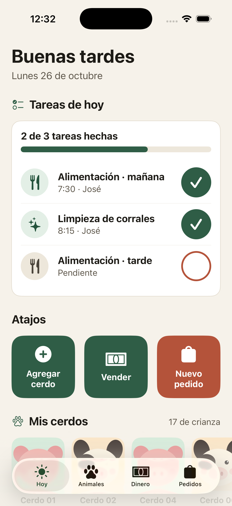
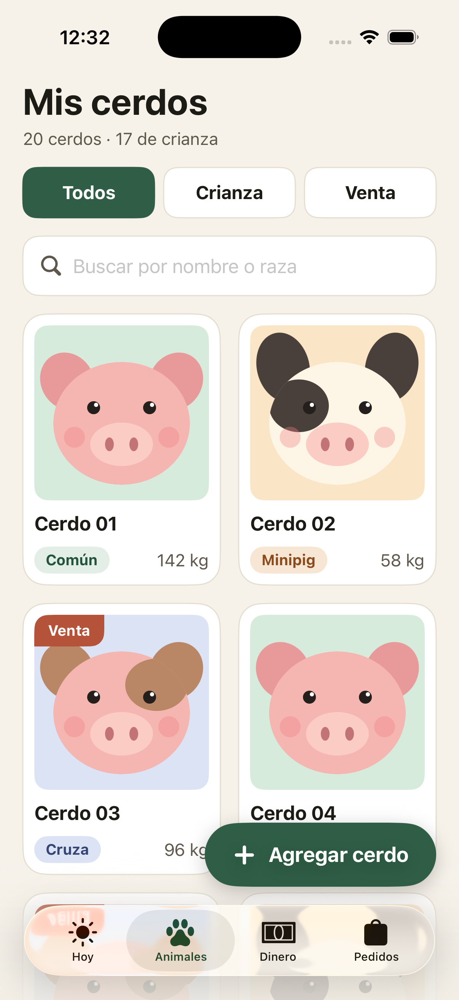
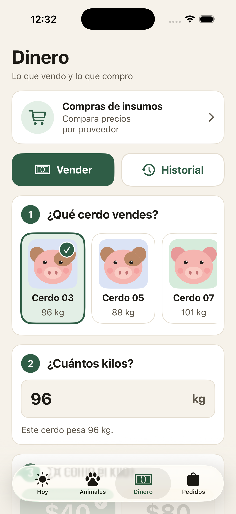
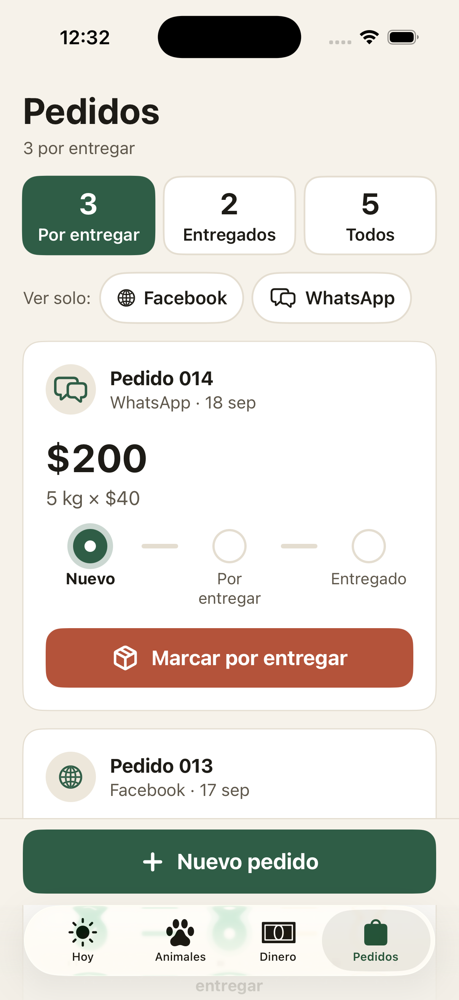

# Finanzas Porcinas 🐷

Aplicación iOS para el **Criadero Fam Rico Moreno**, un emprendimiento familiar de crianza de
puercos en Aldama, Tamaulipas. Es el Proyecto Integrador — **Fase III. Ejecución** — de la materia
*Desarrollo de proyecto de aplicaciones móviles* (Universidad Tecmilenio).

**Alumno:** José Guadalupe Rico Moreno · matrícula AL03063503.

## Qué hace

Concentra en un solo lugar el control del criadero, organizado en cuatro pestañas:

- **Hoy** — tareas del día (alimentación y limpieza), atajos y mis cerdos.
- **Animales** — hato completo con ilustración por raza, ficha, peso, destino y foto.
- **Dinero** — venta en tres pasos, historial, compras y comparación de proveedores.
- **Pedidos** — pedidos por canal (Facebook / WhatsApp) con avance de estado.

Todo en español de México, **local y sin internet**, pensado para usarse de pie, en el corral,
con sol y con guantes: botones grandes, texto grande y una acción principal por pantalla.

## Tecnología

- Xcode 26.4 · Swift 5 · SwiftUI · SwiftData
- iOS 18.0 o superior · sin dependencias externas

## Estructura

```
FinanzasPorcinas/
  FinanzasPorcinasApp.swift   entrada; ModelContainer y siembra de datos
  VistaPrincipal.swift        TabView de 4 pestañas
  Modelos.swift               6 @Model + enumeraciones del dominio
  DatosIniciales.swift        datos de ejemplo del primer arranque
  Tema.swift                  colores, tipografía y componentes
  AvatarCerdo.swift           ilustración del cerdo por raza
  Componentes.swift           AccionRapida, BarraProgreso, ChipRaza, …
  Vistas/                     VistaHoy, VistaAnimales, VistaFichaAnimal,
                              VistaDinero, VistaCompras, VistaVeterinario, VistaPedidos
```

## Ejecutar

```bash
xcodebuild -project FinanzasPorcinas.xcodeproj -scheme FinanzasPorcinas \
  -sdk iphonesimulator -destination 'platform=iOS Simulator,name=iPhone 17 Pro' \
  -configuration Debug build
```

## Pantallas (iteración 3)

| Hoy | Animales | Dinero | Pedidos |
| --- | --- | --- | --- |
|  |  |  |  |

## Documentación

El informe completo de la Fase III está en
[`Entregables/Fase_III_Finanzas_Porcinas.pdf`](Entregables/Fase_III_Finanzas_Porcinas.pdf).
